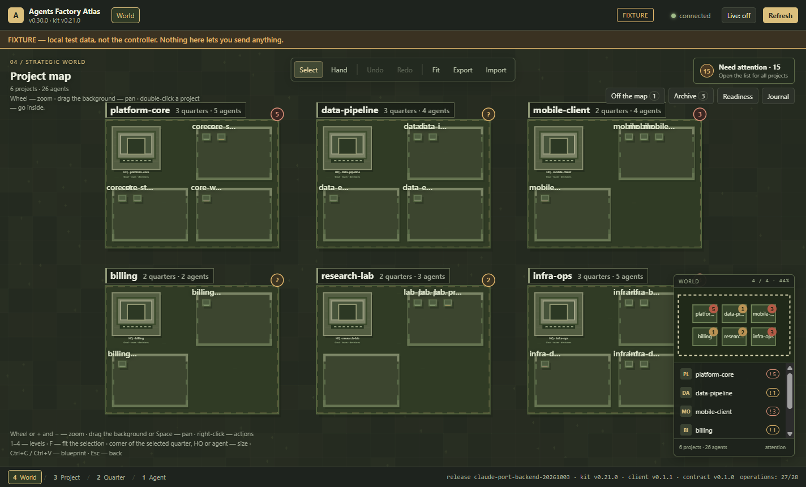
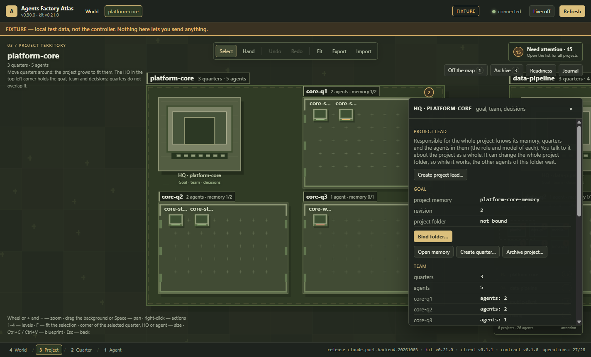
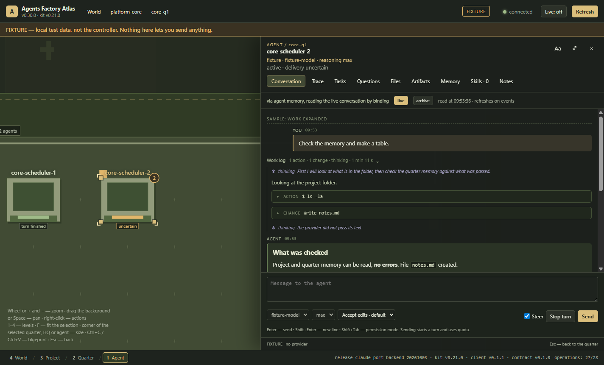

# Agents Factory

**Built for agents.** Agents Factory is a local-first control room for teams
of AI coding agents. It runs many agents side by side on your own machine,
gives each one a project, a role, a memory and a write zone, and shows the
whole team on a strategy-game map - **World → Project → Quarter → Agent** -
with live chats, attention badges and per-turn git history.

It is not tied to one model vendor: today the agents run on Claude through the
[Claude Agent SDK](https://code.claude.com/docs/en/agent-sdk/overview), and on
local or self-hosted models (a local Qwen, a DeepSeek-based harness) through the
Agent Client Protocol (ACP); Codex and more agents are next on the
[roadmap](ROADMAP.md). The system has three parts: an Application Gateway that
hosts the agent sessions, a controller that hands out tasks with verifiable,
hash-bound contracts, and **Atlas**, an Electron desktop app to watch, steer
and approve what the agents do.

If you are looking for a **multi-agent orchestrator for AI coding agents**, a
**desktop app to run several Claude agents in parallel**, **persistent memory
for coding agents**, a way to **limit which files an AI coding agent may
edit**, or a **local, self-hosted control room built on the Claude Agent SDK** -
this is what Agents Factory does.

> **v0.2.0 - working alpha, under active development.** It is the tool its
> author works with every day, so new features and fixes keep landing here -
> see the [roadmap](ROADMAP.md) and [CHANGELOG.md](CHANGELOG.md).
> Windows-first; Node.js 22.13+. Not affiliated with or
> endorsed by Anthropic.



| A project and its HQ: goal, team, the project lead | An agent's chat: work log, thinking, tool calls, steering |
| --- | --- |
|  |  |

<sub>Screenshots from Atlas's built-in fixture data (`frontend\start-atlas-fixture.bat`).</sub>

## Useful for

- running a team of AI coding agents across several repositories at once;
- giving each AI coding agent a role, a memory and a write zone;
- watching and steering agents live: chat, thinking, tool calls, questions;
- reviewing exactly what each agent changed: one git commit per turn;
- handing out tasks to agents with verifiable, hash-bound contracts.

## Why

One coding agent in a terminal is easy to follow. Five agents across three
repositories are not: who is working, who is waiting for an answer, who changed
which files, what each of them was told, and what it may touch. Agents Factory
makes that visible and enforceable:

- **See the team at a glance.** Projects are territories, quarters (features)
  are districts, agents are units with a status frame ("working", "turn
  finished", "waiting for your answer"); attention badges follow you from the
  world view down to a single agent.
- **Give agents memory that survives sessions.** Project, quarter and per-agent
  memory is stored by the backend and delivered with each turn only when it
  changed. Agents propose memory as documents; nothing enters memory without
  the person approving the exact text (by its SHA-256).
- **Keep agents in their lane.** Write zones per agent (`tools/solver/**`),
  project and quarter leads with matching rights, permission modes per agent
  (manual, accept edits, auto, bypass), and a pre-tool hook that refuses edits
  outside the zone.
- **Know what changed.** Every turn that changed files becomes a git commit by
  that agent - only that turn's files, inside its zone - so the history of the
  agents' work is a `git log --author=<agent>` away.
- **Talk to agents as in a coding-agent chat.** Live chat with thinking
  blocks, tool calls, questions with options (single and multiple choice),
  steering a running turn or queueing for its end, model and effort per agent.
- **Hand out work that can be checked.** Controller tasks are immutable,
  hash-bound packets: accepted, planned, reported and accepted again by code,
  not by the agent saying it is done.

## How it works

```
 Atlas (Electron desktop app)                 your projects' folders
   map · chats · memory · approvals              (git, write zones)
          │  loopback HTTP + event stream                ▲
          ▼                                              │ agent tools: read, edit, run
 Application Gateway  ── Claude Agent SDK sessions ──────┘
   operations · receipts · attention · usage meter
          │
          ▼
 Controller: memory store (SQLite), agent catalog, task contracts, journals
```

- **Application Gateway** (`backend/orchestrator/src`, built into one bundle
  with no runtime npm dependencies): one local process that
  hosts every agent as a session of the Claude Agent SDK, exposes typed operations (send,
  steer, interrupt, read the conversation, memory, files, tasks) over a
  loopback-only HTTP API with a bearer token that never leaves the machine, and
  records an operation journal. Every write has an identity and a receipt; an
  uncertain outcome is reconciled, never blindly resent.
- **Controller** (`controller/`): the instance the Gateway works for - the
  memory store, the agent catalog, project folder bindings, task packets and
  reports, PowerShell tools to start, stop and inspect the Gateway.
- **Atlas** (`frontend/`): the desktop window. It loads only a frontend kit
  release the backend accepted (verified by hashes), never reads credentials,
  and asks for confirmation before anything irreversible.

## Quick start (Windows)

Requirements: Windows 10/11, Windows PowerShell 5.1, Node.js 20+ (22
recommended; the memory database runs on its built-in `node:sqlite`, an older
Node falls back to Python 3), Git,
and an **Anthropic API key** ([Claude Console](https://platform.claude.com/)).
The agents' usage is billed to that key.

```powershell
git clone https://github.com/AlexKhutor/agents-factory.git
cd agents-factory

# 1. Atlas and the Claude Agent SDK it ships.
cd frontend; npm install; cd ..

# Try the UI first, on built-in fixture data (no controller, no model calls):
#   frontend\start-atlas-fixture.bat

# 2. A controller instance of your own: it holds the memory database, task
#    packets and reports. The agents-factory CLI copies the template outside the
#    repository and points it at the SDK Atlas ships.
node controller\.orchestrator\runtime\agents-factory.mjs setup --template .\controller `
  --instance C:\agents-control --sdk-path "$PWD\frontend\node_modules\@anthropic-ai\claude-agent-sdk" --no-start

# 3. Your API key: typed hidden, kept in the system key store (DPAPI), passed
#    only to the Gateway. (Atlas's readiness panel can do the same.)
node C:\agents-control\.orchestrator\runtime\agents-factory.mjs key set

# 4. Start the Gateway and point Atlas to it, then open Atlas.
node C:\agents-control\.orchestrator\runtime\agents-factory.mjs setup `
  --instance C:\agents-control --atlas-config frontend\config\local.json
frontend\start-atlas.bat
```

Atlas's readiness panel starts and stops the Gateway from then on, and can turn
on its autostart at logon. `agents-factory doctor` checks the whole setup;
the CLI reference is in [docs/distribution/cli.md](docs/distribution/cli.md).

The controller's own [README](controller/README.md) covers desk agents, the
coordinator and task contracts; [claude-code-provider.md](backend/orchestrator/docs/claude-code-provider.md)
covers models, permission modes and the SDK settings. A one-file installer is
in progress: see [docs/distribution](docs/distribution/README.md).

## Repository layout

| Path | What |
| --- | --- |
| `backend/orchestrator/src` | Application Gateway, memory service, Claude Agent SDK session host, write zones, task tools |
| `backend/orchestrator/test` | Backend test suites (`node --test`) |
| `backend/orchestrator/docs` | Guides: architecture, Claude Code provider, project memory, attention, security |
| `backend/orchestrator/src/agents-factory-*.mjs` | The `agents-factory` CLI: Gateway lifecycle, user service, key store, setup, SDK install |
| `backend/tools` | PowerShell tools for the Gateway's lifecycle (the CLI does the same in Node) |
| `controller/` | The controller instance template to copy |
| `frontend/` | Atlas, the Electron desktop app, and its tests |
| `docs/distribution` | The plan for the installer, the CLI, MCP and telemetry |

## Security and privacy

- Everything runs locally. The Gateway listens on loopback only; its bearer
  token stays in the controller's machine-local folder.
- The API key reaches the agents only through the Gateway's environment; Atlas
  never reads it or any other credential.
- Irreversible actions (archiving, folder binding, memory writes, "bypass"
  permission mode, git init) go through a confirmation of the trusted host.
- Agents' commits are local; nothing is pushed anywhere by the system.
- **No telemetry in v0.2.0.** When telemetry comes, it will be anonymous, used
  only to improve the product, sent only if you agree, and you can turn it off
  at any time - see [PRIVACY.md](PRIVACY.md).

See [SECURITY.md](SECURITY.md).

## Tests

```powershell
cd backend/orchestrator; npm ci; node scripts/run-tests.mjs   # backend suites (dev tools: esbuild, ajv)
cd frontend; npm test                                         # Atlas unit suites
cd frontend; npm run test:ui                                  # Atlas UI scenes (opens windows)
```

No test calls a model: the backend suites use a fake Claude Agent SDK, and
Atlas's suites use fixture data and a fake Gateway.

## Roadmap

Agents Factory keeps evolving: it is developed together with the work it is
used for, and improvements land here regularly ([CHANGELOG.md](CHANGELOG.md)).
Next: **autonomy with the person in charge** (a task mode in which the agent
plans first and works once the plan is approved; the world lead handing out
tasks), **statistics and budgets**, a **task board** next to the map, hover
cards on the map, bringing an existing Claude Code project in, routines, more
providers (Codex next), and a **one-file installer** with a CLI and MCP
([plan](docs/distribution/README.md)). Later: unattended work only in a
sandbox, themes, and a **VR cockpit** - the agent map and chats in a headset,
with a PlayStation VR2 and SteamVR prototype from earlier research. The full list is in
[ROADMAP.md](ROADMAP.md); ideas and bug reports are welcome in
[Issues](https://github.com/AlexKhutor/agents-factory/issues).

## License

GNU Affero General Public License v3.0 only (AGPL-3.0-only), with an
additional permission to combine the program with the Claude Agent SDK - see
[NOTICE.md](NOTICE.md) and [LICENSE](LICENSE). Third-party components keep
their own licenses.
